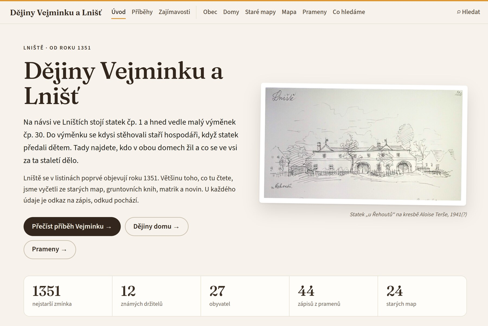
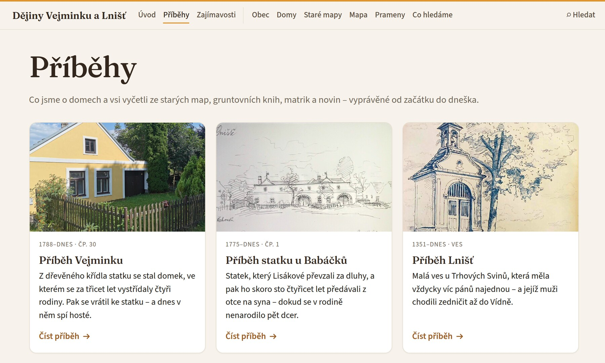
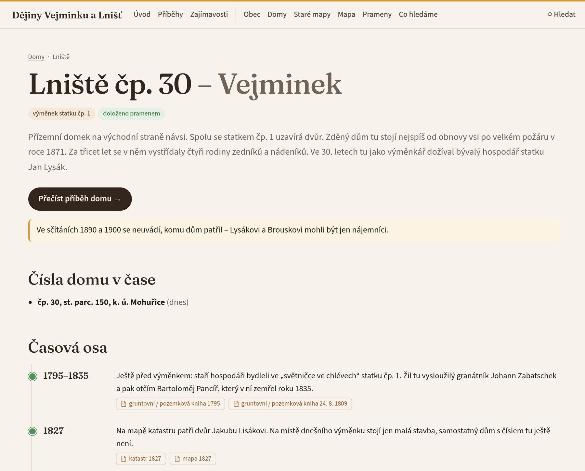

# Dějiny domu – skill pro Claude Code

Claude vás provede **dějinami vašeho domu, chalupy nebo statku a celé vsi**: od toho, co o domě víte, přes digitalizované
archivy (sčítání lidu, matriky podle čísla domu, stabilní katastr, gruntovní knihy, staré mapy, noviny, literatura) až
k webu s časovou osou domu, držiteli, obyvateli, výřezy původních zápisů s přepisem a překladem a porovnáním starých map.
Je určený pro lidi, kteří v archivu nikdy nebádali a neprogramují – technickou práci dělá Claude, vy dodáváte znalost
místa a rozhodujete.

Skill je odvozený ze skillu [**rodokmen**](https://github.com/sarsonj/rodokmen-skill) Jindřicha Šaršona (verze 0.5.0).
Nástroje na archivy, čtení snímků, výřezy, deník hledání a web jsou společné; rozdíl je v tom, že se data točí kolem
**čísla popisného** a lidí, kteří v domě v čase žili a vlastnili ho, ne kolem předků jedné osoby. Děkuji autorovi
rodokmenu za skvělý základ.

**Aktuální verze: 0.3.7 (říjen 2026), rané vydání.** Skill vznikl při zjišťování dějin jednoho domu a zatím byl
vyzkoušený jen na něm (Linux). Počítejte s chybami a dejte mi o nich vědět.

## Ukázka

**Živá ukázka: [historie.malystatek.cz](https://historie.malystatek.cz/)**. Tento web vznikl se skillem a popisuje
výměnek čp. 30 a statek čp. 1 v Lništi (obec Slavče, okres České Budějovice).



<table><tr>
<td></td>
<td></td>
</tr><tr>
<td>Příběhy domů a vsi vyprávěné od začátku do dneška</td>
<td>Stránka domu: časová osa, každý údaj má odkaz na pramen</td>
</tr></table>

> **Než začnete**
>
> Skill **nenahrazuje historika ani zkušeného badatele**. Umělá inteligence dělá chyby: špatně přečte jméno, splete
> si dva Jany ze stejné vsi nebo přiřadí zápis k jinému domu (čísla domů se v 19. století měnila). Skill se tomu
> snaží bránit – u každého údaje je zdroj a výřez původního zápisu a nejisté věci jsou označené. Za správnost ale
> ručíte vy.

## Co budete potřebovat
- **Claude Code** (aplikace nebo příkazová řádka) a placené předplatné Claude. Bádání je dlouhá práce a spotřebuje
  dost kreditů; tarif Pro stačí na vyzkoušení.
- Programy **Python 3, Node.js, ImageMagick a git**. Claude zkontroluje, co chybí, a pomůže s instalací.
- Volitelně účet na [Netlify](https://www.netlify.com) (zdarma), pokud chcete web zveřejnit.

## Instalace

### Varianta A – jako plugin (doporučeno)
V Claude Code napište:
```
/plugin marketplace add vzoha/dejiny-domu-skill
/plugin install dejiny-domu@dejiny-domu-skill
```
Pak Claude Code restartujte. Aktualizace později: `/plugin marketplace update dejiny-domu-skill`. Rozpracovaný projekt
pak Claude sám nabídne aktualizovat (vaše data zůstanou).

### Varianta B – ručně
Stáhněte repozitář a zkopírujte složku `skills/dejiny-domu` do `~/.claude/skills/` (na Windows
`C:\Users\<jméno>\.claude\skills\`). Výsledek: `~/.claude/skills/dejiny-domu/SKILL.md`. Pak Claude Code restartujte.

## První spuštění
1. Spusťte Claude Code a napište třeba *„Chci zjistit historii našeho domu, čp. 12 v Horní Lhotě.“* nebo `/dejiny-domu`.
2. Claude zkontroluje programy, založí složku projektu a začne se ptát, co o domě víte. Připravte si kupní smlouvy,
   staré fotky, výpisy z katastru, knihy o obci a co vyprávěli sousedé.
3. **Příště otevírejte Claude Code přímo ve složce projektu.** Claude si přečte, kde jste skončili, a naváže.

## Jak to probíhá
| Fáze | Co děláte vy | Co dělá Claude |
|---|---|---|
| 0. Příprava | potvrdíte instalaci programů | založí projekt, ověří dnešní obec a parcelu (RÚIAN) |
| 1. Co už víme | dodáte dokumenty a vzpomínky | zapisuje, čte knihy a dokumenty |
| 2. Kostra | – | zjistí farnost, panství, archiv a čísla domu v čase |
| 3. Prameny | rozhodujete sporná místa | sčítání lidu, matriky, katastry, gruntovní knihy: stahuje, čte, dělá výřezy, přepisy a překlady, vede deník |
| 4.–5. Obec a příběhy | doplníte místní historky, schválíte texty | dějiny obce, zajímavosti, příběh domu |
| 6.–7. Web | díváte se a říkáte, co upravit; schválíte zveřejnění | staví web, ukazuje náhled, nasadí ho |

## Co je v repozitáři
```
skills/dejiny-domu/
  SKILL.md           průvodce pro Clauda (fáze, pravidla)
  reference/         návody: prameny k domu a obci, čtení matrik, portály archivů, formát dat, web, texty, soukromí
  tools/             nástroje v Pythonu (archivy, Archiv ČÚZK, RÚIAN, výřezy, rámečky, kontrola dat, export do webu)
  template/          šablona projektu: prázdná data a web (Astro)
.claude-plugin/      instalace jako plugin
```

## Soukromí
Projekt zůstává na vašem počítači. Claude má pokyn nedávat na web údaje o žijících lidech a dnešních majitelích bez
souhlasu a před zveřejněním s vámi projít, co web říká – rozhodnutí je ale na vás. Pokud projekt zálohujete na GitHub,
použijte **soukromý** repozitář.

## Bezpečnost
Skill je text (návod pro Clauda) a skripty v Pythonu, které si můžete před instalací prohlédnout. Plugin nemá hooky ani
MCP servery; skripty spouští jen Claude, když je potřebuje, a Claude Code se vás na ně zeptá. Zapisují do složky
projektu, jen společný limit rychlosti k archivům si drží stav ve `~/.cache/dejiny-domu/`. Do projektu skill zapíše
hook (`.claude/settings.json` → `tools/hlidac.py`), který Claudovi nedovolí posílat na weby dotazy mimo ten limit –
archivy po sérii rychlých dotazů blokují IP adresu. Chodí na archivní portály (SOA Třeboň, ARON, Porta fontium,
eBadatelna, AHMP, MZA Brno, Národní archiv, SOA Litoměřice, Matricula, Archiv ČÚZK, IPR Praha), noviny (ANNO, Kramerius), OpenStreetMap a při instalaci webu do registru npm; na Netlify jen
tehdy, když web sami zveřejníte. Instalujte skilly jen od lidí, kterým věříte.

## Zpětná vazba
Chyby a nápady prosím [zakládejte jako issue](https://github.com/vzoha/dejiny-domu-skill/issues/new). Issues jsou
veřejné – nepište do nich údaje o žijících lidech. Claude si během práce zapisuje do `poznamky_pro_skill.md`
(v projektu), co by šlo zlepšit; ty můžete do issue zkopírovat.

## Licence
[MIT](LICENSE) – smíte skill volně používat, upravovat a šířit, jen zachovejte uvedení autorů (včetně autora rodokmenu).
Výjimkou je metodická příručka `skills/dejiny-domu/reference/playbook.md` převzatá z rodokmenu; licence MIT se na ni
nevztahuje (podrobnosti na začátku souboru).
